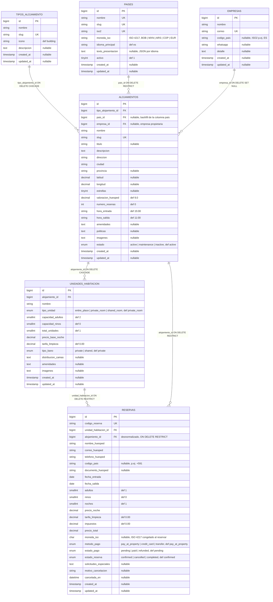

# HospedaYa — Sistema de Reserva de Alojamientos Multitipo

Plataforma completa de reservas para **Hoteles, Hostales, Cabañas, Apartamentos Turísticos y Glamping**, construida con arquitectura desacoplada: **Laravel 12 (API REST) + MySQL** en el backend y **React 19 (Vite + Tailwind CSS)** en el frontend.

---

## 🚀 Arquitectura y Tecnologías

- **Backend:** [Laravel 12](file:///d:/Cursos/TallerCloudeIA/project-multmodule/backend) (PHP 8.2)
- **Base de Datos:** MySQL (MariaDB 10.4 en XAMPP, motor `InnoDB`, charset `utf8mb4`)
- **Frontend:** [React 19 + Vite + Tailwind CSS](file:///d:/Cursos/TallerCloudeIA/project-multmodule/frontend)
- **Iconografía:** Lucide React (`lucide-react`)
- **HTTP Client:** Axios
- **Teléfonos:** [giggsey/libphonenumber-for-php](https://github.com/giggsey/libphonenumber-for-php) (metadatos de la UIT) para validar los WhatsApp del formulario de alta
- **Mapas:** Google Maps por `iframe` (`output=embed`), sin clave ni facturación, en la ficha del alojamiento

---

## 📁 Estructura del Proyecto

```
project-multmodule/
├── backend/                               # API REST Laravel
│   ├── app/
│   │   ├── Http/Controllers/Api/          # AccommodationController, AccommodationTypeController, ReservationController
│   │   ├── Models/                        # AccommodationType, Accommodation, RoomUnit, Reservation
│   │   ├── Models/Concerns/               # TraduceColumnas (columnas en español / API en inglés)
│   │   └── Services/                      # ReservationService (Validación de fechas, overbooking & cálculos)
│   ├── database/
│   │   ├── migrations/                    # Tablas relacionales con índices optimizados en MySQL
│   │   └── seeders/                       # Hoteles, Hostales, Cabañas, Apartamentos y Glamping con fotos reales
│   └── routes/api.php                     # Endpoints REST
│
└── frontend/                              # SPA React
    ├── src/
    │   ├── components/                    # Navbar, SelectorIdioma, SearchBar, CategoryPills, CountryPills, FilterSidebar, AccommodationCard, AccommodationDetail, MapaGoogle, GaleriaFotos, BookingModal, MyBookings
    │   ├── services/api.js                # Cliente Axios conectado al backend
    │   ├── seo/                           # idiomas.js, copys.js, metadatos.js, sitio.js
    │   └── App.jsx                        # Orquestación de vistas, filtros y modales
    └── package.json
```

---

## 🗄️ Esquema de Base de Datos (en español)

Las tablas y columnas del dominio están en español. Las migraciones de Laravel (`users`, `cache`, `jobs`, `personal_access_tokens`, etc.) conservan sus nombres originales porque el framework las busca por su nombre en inglés.

| Tabla en inglés | Tabla en español | Contenido |
| :--- | :--- | :--- |
| `accommodation_types` | `tipos_alojamiento` | Hoteles, Hostales, Cabañas, Apartamentos y Glamping |
| `countries` | `paises` | Países con slug, ISO2, idioma principal y texto de presentación por idioma |
| `accommodations` | `alojamientos` | Propiedades (con tipo, país, ubicación, valoraciones y fotos) |
| `room_units` | `unidades_habitacion` | Habitaciones, unidades, camas o cabaña completa |
| `reservations` | `reservas` | Reservas con su desglose de precio y estado |
| `companies` | `empresas` | Solicitudes de alta con nombre, correo, país (ISO2), WhatsApp y detalle |

### Diagrama entidad-relación



`PK` clave primaria · `UK` único · `FK` clave foránea · `def` valor por defecto · `nullable` admite `NULL`

El modelo es una jerarquía de **1 a N** en tres niveles: un tipo de alojamiento tiene muchas propiedades, cada propiedad muchas unidades (habitaciones, camas o la cabaña entera), y cada unidad muchas reservas.

Las reservas **cuelgan de la unidad**, que es lo que lleva el inventario (`total_unidades`) y el precio: dos reservas de la misma propiedad pueden ser de habitaciones distintas y eso es justo lo que hay que comprobar para no sobrevender. También apuntan a la propiedad por `alojamiento_id`, pero esa relación es **desnormalizada y de solo lectura**: existe para no tener que cruzar `unidades_habitacion` → `alojamientos` cada vez que se necesita saber a qué hotel o en qué moneda pertenece una reserva, no para consultar o modificar la reserva a través de ella. El precio y la moneda se sacan siempre de la unidad.

Hay dos versiones del archivo: [`docs/diagrama-bd.mmd`](file:///d:/Cursos/TallerCloudeIA/project-multmodule/docs/diagrama-bd.mmd) (Mermaid editable) y `docs/diagrama-bd.png` (imagen). Para regenerar el PNG: `npx @mermaid-js/mermaid-cli -i docs/diagrama-bd.mmd -o docs/diagrama-bd.png -b white -w 1600`.

<details>
<summary>Correspondencia completa de columnas (56)</summary>

**`tipos_alojamiento`** — `name`→`nombre`, `icon`→`icono`, `description`→`descripcion`

**`alojamientos`** — `accommodation_type_id`→`tipo_alojamiento_id`, `name`→`nombre`, `headline`→`titulo`, `description`→`descripcion`, `address`→`direccion`, `city`→`ciudad`, `state`→`provincia`, `country`→`pais`, `company_id`→`empresa_id`, `latitude`→`latitud`, `longitude`→`longitud`, `star_rating`→`estrellas`, `guest_rating`→`valoracion_huesped`, `reviews_count`→`numero_resenas`, `check_in_time`→`hora_entrada`, `check_out_time`→`hora_salida`, `amenities`→`amenidades`, `policies`→`politicas`, `images`→`imagenes`, `status`→`estado`, `currency`→`moneda_iso` (derivada de `pais`)

**`unidades_habitacion`** — `accommodation_id`→`alojamiento_id`, `name`→`nombre`, `unit_type`→`tipo_unidad`, `capacity_adults`→`capacidad_adultos`, `capacity_children`→`capacidad_ninos`, `total_units`→`total_unidades`, `base_price_per_night`→`precio_base_noche`, `cleaning_fee`→`tarifa_limpieza`, `bathroom_type`→`tipo_bano`, `bed_distribution`→`distribucion_camas`, `amenities`→`amenidades`, `images`→`imagenes`

**`reservas`** — `reservation_code`→`codigo_reserva`, `room_unit_id`→`unidad_habitacion_id`, `accommodation_id`→`alojamiento_id`, `guest_name`→`nombre_huesped`, `guest_email`→`correo_huesped`, `guest_phone`→`telefono_huesped`, `guest_country_code`→`codigo_pais`,             `guest_document_id`→`documento_huesped`, `check_in_date`→`fecha_entrada`, `check_out_date`→`fecha_salida`, `adults_count`→`adultos`, `children_count`→`ninos`, `nights`→`noches`, `price_per_night`→`precio_noche`, `cleaning_fee`→`tarifa_limpieza`, `taxes`→`impuestos`, `total_price`→`precio_total`, `currency`→`moneda_iso`, `payment_method`→`metodo_pago`, `payment_status`→`estado_pago`, `reservation_status`→`estado_reserva`, `special_requests`→`solicitudes_especiales`, `cancellation_reason`→`motivo_cancelacion`, `cancelled_at`→`cancelada_en`

</details>

### Convención bilingüe del backend

La base de datos habla español; **la API y el dominio siguen en inglés**, así que el frontend React no necesitó ningún cambio. El trait `App\Models\Concerns\TraduceColumnas` hace la traducción mediante el mapa `protected static $columnas` de cada modelo, que se aplica en `getAttribute()`, `setAttribute()` y `attributesToArray()`.

Al trabajar en el backend, hay que distinguir dos contextos:

| Contexto | Nombre a usar | Ejemplo |
| :--- | :--- | :--- |
| Modelo (lectura, `create()`, `update()`, `$fillable`, validaciones, JSON) | Inglés | `$unidad->total_units`, `Reservation::create(['room_unit_id' => $id])` |
| Consultas SQL (`where`, `orderBy`, `whereRaw`, `exists:tabla`, relaciones) | Español | `->where('total_unidades', ...)`, `'exists:unidades_habitacion,id'`, `->hasMany(RoomUnit::class, 'alojamiento_id')` |

El mapa cubre atributos y serialización, **pero no las consultas**: `Reservation::where('guest_email', ...)` falla en tiempo de ejecución, hay que escribir `where('correo_huesped', ...)`. Los valores de los `ENUM` (`active`, `confirmed`, `pay_at_property`…) y las claves del JSON de la API también se mantienen en inglés.

### Migración de traducción

`database/migrations/2026_09_30_090000_translate_database_schema_to_spanish.php` renombra tablas, columnas, índices y claves foráneas conservando los datos (no recrea las tablas). Es reversible con `php artisan migrate:rollback --step=1`.

> Las columnas se renombran con `ALTER TABLE ... CHANGE` y no con `renameColumn()` porque en **MariaDB 10.4** Laravel recompone la definición de la columna y vuelve a entrecomillar el valor por defecto que el motor ya devuelve entrecomillado. El resultado sería `DEFAULT '''15:00'''` (un `varchar` con comillas dentro del valor) y un error en las columnas `enum`.

> Las claves foráneas se sueltan y se vuelven a declarar, porque ni `CHANGE` ni `RENAME TABLE` tocan el nombre de la restricción (habría quedado `accommodations_accommodation_type_id_foreign` sobre la tabla `alojamientos`) y **MySQL no tiene `RENAME CONSTRAINT`**. Quedan así:

| Restricción anterior | Restricción actual | Regla |
| :--- | :--- | :--- |
| `accommodations_accommodation_type_id_foreign` | `alojamientos_tipo_alojamiento_id_foreign` | `ON DELETE CASCADE` |
| `room_units_accommodation_id_foreign` | `unidades_habitacion_alojamiento_id_foreign` | `ON DELETE CASCADE` |
| `reservations_room_unit_id_foreign` | `reservas_unidad_habitacion_id_foreign` | `ON DELETE RESTRICT` |

Solo quedan en inglés los objetos que no traducen nada: la columna `slug` de `alojamientos` y `tipos_alojamiento` (`slug` no tiene palabra española equivalente y es el mismo término).

### Índices

Los índices no salen en el diagrama, pero son la parte que hace que la búsqueda funcione:

| Índice | Tabla | Columnas | Para qué sirve |
| :--- | :--- | :--- | :--- |
| `idx_alojamientos_busqueda` | `alojamientos` | `ciudad`, `tipo_alojamiento_id`, `estado` | Filtro principal del buscador en una sola pasada |
| `alojamientos_ciudad_index` | `alojamientos` | `ciudad` | Autocomplete de ciudades y filtro `?city=`, que compara de forma exacta |
| `idx_alojamientos_valoracion` | `alojamientos` | `valoracion_huesped` | Ordenar por puntuación |
| `alojamientos_slug_unique` | `alojamientos` | `slug` | URL pública de la propiedad |
| `tipos_alojamiento_slug_unique` | `tipos_alojamiento` | `slug` | Buscar el tipo por su clave |
| `idx_unidades_alojamiento_precio` | `unidades_habitacion` | `alojamiento_id`, `precio_base_noche` | Listar unidades de una propiedad ordenadas por precio |
| `idx_disponibilidad_reserva` | `reservas` | `unidad_habitacion_id`, `estado_reserva`, `fecha_entrada`, `fecha_salida` | **Preventor de overbooking**: cuenta las reservas vivas que solapan un rango de fechas |
| `reservas_codigo_reserva_unique` | `reservas` | `codigo_reserva` | Código `BK-XXXXXXX` único e indexado para el lookup |
| `reservas_alojamiento_id_foreign` | `reservas` | `alojamiento_id` | Evita cruzar `unidades_habitacion` → `alojamientos` para saber en qué moneda o a qué propiedad pertenece una reserva |
| `reservas_correo_huesped_index` | `reservas` | `correo_huesped` | Buscar la reserva de un huésped |
| `reservas_fecha_entrada_index` / `reservas_fecha_salida_index` | `reservas` | `fecha_entrada`, `fecha_salida` | Estadísticas y ocupación por periodo |

`idx_disponibilidad_reserva` es el índice que sostiene la comprobación de disponibilidad de `ReservationService`: como empieza por `unidad_habitacion_id` y `estado_reserva`, MySQL resuelve el recuento de solapamientos sin recorrer la tabla.

---

## ⚙️ Configuración y Ejecución

### 1. Base de Datos MySQL
La base de datos utilizada es `alojamientos_db` en el servidor MySQL local (XAMPP).
Las credenciales están configuradas en `backend/.env`:
```env
DB_CONNECTION=mysql
DB_HOST=127.0.0.1
DB_PORT=3306
DB_DATABASE=alojamientos_db
DB_USERNAME=root
DB_PASSWORD=
```

### 2. Iniciar el Backend (Laravel)
En la carpeta `backend/`:
```bash
# Migraciones y seeders (si se desea reiniciar):
php artisan migrate:fresh --seed

# Iniciar servidor de desarrollo en puerto 8000:
php artisan serve --port=8000
```
La API estará disponible en `http://127.0.0.1:8000/api`.

### 3. Iniciar el Frontend (React)
En la carpeta `frontend/`:
```bash
# Instalar dependencias (ya instaladas):
npm install

# Iniciar servidor Vite:
npm run dev
```
La aplicación web estará disponible en `http://localhost:5173/`.

---

## 🏨 Tipos de Alojamiento Soportados

1. **Hoteles:** Habitaciones privadas (individuales, dobles, suites) con baño privado, clasificación por estrellas (1 a 5) y servicios completos.
2. **Hostales:** Camas en dormitorios compartidos o habitaciones privadas económicas, diferenciación de baño privado o compartido, áreas comunes y ambiente social.
3. **Cabañas:** Lugares enteros (`entire_place`) en contacto con la naturaleza, chimenea, parrilla, tarifa de limpieza y cocina equipada.
4. **Apartamentos Turísticos:** Unidades completas con cocina, WiFi de alta velocidad, cerradura inteligente para auto check-in.
5. **Glamping:** Domos geodésicos y tiendas de lujo con comodidades exclusivas al aire libre.

---

## 📡 Endpoints de la API REST

| Método | Ruta | Descripción |
| :--- | :--- | :--- |
| `GET` | `/api/accommodation-types` | Lista todas las categorías y cantidad de propiedades activas |
| `GET` | `/api/cities` | Autocomplete del buscador. Acepta `?country=` (slug o ISO2) para devolver solo las ciudades de ese país |
| `GET` | `/api/destinations` | Catálogo editorial de destinos turísticos (Salar de Uyuni, Cartagena...). Acepta `?country=` y `?lang=` para traducir la presentación |
| `GET` | `/api/destinations/{slug}` | Detalle de un destino con los alojamientos publicados en su ciudad (resueltos por país + ciudad) |
| `GET` | `/api/accommodations` | Búsqueda avanzada con filtros (categoría, texto libre, **país**, **ciudad**, fechas, huéspedes, precio, tipo de baño, amenidades) |
| `GET` | `/api/accommodations/{id}` | Detalle completo de la propiedad y sus unidades disponibles |
| `GET` | `/api/accommodations/slug/{slug}` | Detalle completo por slug. Es el que usa la URL pública `/es/alojamiento/{slug}` |
| `GET` | `/api/countries` | Lista los países con `slug`, `iso2`, `locale`, texto de presentación y número de alojamientos |
| `GET` | `/api/countries/{slug}` | Detalle de un país, opcionalmente con `?lang=en` para pedir otro idioma |
| `POST` | `/api/reservations/preview` | Cálculo de tarifa en vivo (noches, subtotal, tarifa de limpieza e impuestos) |
| `POST` | `/api/reservations` | Registro y confirmación de reserva con generación de código único (`BK-XXXXXXX`); exige `guest_country_code` (ISO2) y un `guest_phone` válido para ese país. Envía el aviso por correo a la empresa y a HospedaYa (ver más abajo) |
| `POST` | `/api/reservations/lookup` | Consulta de reserva por código y correo |
| `PUT` | `/api/reservations/{code}/cancel` | Cancelación de reserva y liberación de inventario |
| `GET` | `/api/company-countries` | Catálogo de los 245 países con prefijo y número de ejemplo para el formulario de alta |
| `GET` | `/api/companies` | Lista pública de solicitudes de alta (más recientes primero) |
| `POST` | `/api/companies` | Registra una solicitud con nombre, correo, país y WhatsApp; el correo es único |

### El país del teléfono en los formularios públicos

El alta de `/registro-hotel` y el modal de reserva ofrecen los **245 países** con los
que la UIT define numeración, no solo los del catálogo de alojamientos. Un huésped
reserva desde fuera, así que limitar ambos selectores a los cinco países con
alojamientos publicados los dejaría fuera por el simple hecho de estar de viaje.

| Endpoint | Contenido | Quién lo usa |
| --- | --- | --- |
| `GET /api/company-countries` | Los 245 países, con prefijo y número de ejemplo | Alta de hotel y reserva |
| `GET /api/countries` | Los países con alojamientos publicados | Buscador y páginas `/paises/<slug>` |

Mezclarlos añadiría a las páginas de país páginas de países sin ningún alojamiento.

Los dos formularios validan el teléfono con libphonenumber y guardan el número
nacional, sin prefijo ni prefijo troncal, junto al prefijo del país. Un número que
no pertenezca al país elegido se rechaza: guardado tal cual, llevaría un prefijo que
no le corresponde y ni el enlace de WhatsApp del alta ni la llamada de confirmación
de la reserva apuntarían al número correcto. El huésped puede escribirlo como lo
conozca, `600 123 456`, `+34 600 123 456` o `+34 (600) 12-34-56` dan lo mismo.

Tres decisiones que conviene tener presentes al tocar este flujo:

1. **El selector manda ISO2 (`BO`, `MX`) y no el prefijo.** El prefijo no identifica a
   un país: `+1` lo comparten veinticuatro y `+44` cuatro, así que al ofrecer todos los
   países el mismo prefijo describiría varios a la vez.
2. **Cada tabla guarda lo que necesita.** `empresas.codigo_pais` guarda el ISO2,
   porque allí el país identifica a la empresa y hay que distinguir las 24 regiones del
   `+1`; la migración `2026_10_05_090000_normalize_empresa_country_to_iso2.php` reescribió
   las filas anteriores. `reservas.codigo_pais` guarda el prefijo (`+591`), porque allí
   el país solo sirve para marcar el teléfono del huésped.
3. **La validación es del backend y es la única que decide.** El navegador solo
   descarta lo que no puede ser un teléfono (menos de 4 o más de 15 dígitos); los
   patrones por país viven en los metadatos de la UIT, no replicados en el cliente. El
   mensaje de error incluye el ejemplo del país elegido para que el visitante vea qué
   se espera.

### El aviso de reserva por correo

Al confirmarse una reserva (`POST /api/reservations`), `ReservationService` envía un
correo con el detalle (código, fechas, huésped, desglose y total) a **dos destinos**:

1. El correo de la **empresa propietaria** del alojamiento (`empresas.correo`, llegado a
   través de `alojamientos.empresa_id`).
2. **`HOSPEDAYA_EMAIL`** (`config('mail.hospedaya')`, por defecto
   `reservas@hospedaya.com`), como respaldo de la plataforma.

Si el alojamiento no tiene empresa vinculada, el correo sale igualmente, solo para el
respaldo: una reserva no debe perderse por no tener `empresa_id`. Si ambos destinos
coinciden, se envía una sola copia.

Tres decisiones que conviene no olvidar:

- **El envío va después de la transacción,** nunca dentro: la fila ya está escrita y
  confirmada, así que un fallo de SMTP no puede deshacer la reserva.
- **Un fallo de envío no falla la petición.** El error se traga y se registra con
  `Log::warning`; si subiera al controlador, el cliente recibiría un 422 con la reserva
  ya creada en la base de datos.
- **Se envía síncrono, no encolado.** `QUEUE_CONNECTION=database` no tiene worker
  configurado en el proyecto, así que una cola dejaría los avisos en la tabla `jobs`
  para siempre. Si algún día se añade worker, mover `notificarReserva()` a un job es el
  cambio natural.

El Mailable es `App\Mail\ReservationConfirmation` y la plantilla
`resources/views/mail/reservation-confirmation.blade.php`. En desarrollo
`MAIL_MAILER=log`, así que los correos acaban en `storage/logs/laravel.log`; para
entregarlos de verdad hay que configurar un transport real (`MAIL_MAILER=smtp` y
credenciales en `.env`).

### El mapa de la ficha

La página `/alojamiento/:slug` muestra un mapa de Google con el punto del alojamiento,
tomado de `alojamientos.latitud` y `alojamientos.longitud`, que la API ya entrega como
`latitude` y `longitude`. El JSON-LD ya publicaba `geo: GeoCoordinates`, así que no hizo
falta tocar el backend. El mapa vive solo en `MapaGoogle.jsx` y en la página de detalle:
el modal de la home lo excluye con `mostrarMapa` porque es un bloque alto que empuja el
precio y el botón de reservar fuera de la vista sin aportar nada.

El mapa se obtiene con el canal gratuito, sin clave y sin facturación:

```
https://maps.google.com/maps?q=LAT,LNG&z=16&hl=IDIOMA&output=embed
```

Decisiones que conviene no olvidar al retomar esto:

- **No usa ninguna API de pago, y eso es deliberado.** Las APIs con clave (JS API,
  Embed API) exigen facturación activa, y sin ella Google superpone la marca de agua
  "solo para desarrollo". El `output=embed` responde con un iframe y no necesita ni clave
  ni tarjeta. La alternativa de pago, la Embed API, tiene además **tope de uso
  ilimitado sin coste**, así que si algún día hace falta el canal soportado, la clave no
  cuesta dinero: cambia el `src` del iframe y ya está.
- **`output=embed` no es un canal documentado por Google.** Funciona, pero puede dejar de
  funcionar sin previo aviso. Es lo que permite tener un mapa de Google sin abrir una
  cuenta de facturación, y es una decisión consciente, no un descuido.
- **El punto se marca con `q=LAT,LNG`,** que ya centra y marca la ubicación. No se usa
  `markers=` ni `zoom=`: esos parámetros son de la Embed API de pago, y en este canal el
  zoom va en `z=`.
- **`hl` sigue al idioma activo.** Ese parámetro decide los rótulos del mapa (nombres de
  calles, controles), así que si se dejara fijo en `es` la ficha en inglés enseñaría el
  mapa en español.
- **Las coordenadas se descartan antes de convertir, no después.** `Number('')` es `0`, y
  `0,0` es un punto real en el golfo de Guinea: un alojamiento sin coordenadas aparecería
  en mitad del océano. El componente muestra un aviso en su lugar.
- **No hay botón de "cómo llegar".** Se quitó porque tardaba demasiado en abrir, y la
  causa era el `origin`: para pasarle la ubicación del visitante había que pedirle la
  geolocalización al navegador, con su aviso de permiso y la espera a que la posición
  estuviera fixada. Durante esa espera se abría una pestaña en blanco, porque abrirla
  después la habría cerrado el bloqueador de popups. En la práctica era un clic sin
  efecto visible durante segundos, en una ficha que ya tiene el mapa delante. Si vuelve a
  hacer falta, es una línea: `https://www.google.com/maps/dir/?api=1&destination=LAT,LNG`.
  Ese enlace sin `origin` ya es el que Google documenta para "desde mi ubicación", porque
  el parámetro es opcional y si no se envía Google usa por su cuenta la ubicación del
  dispositivo; en el móvil sale la ruta correcta sin pedirle nada a la web.
- **No hay nada que limpiar en el desmontaje.** Todo el mapa va dentro del iframe, así que
  no hay instancia que destruir ni efectos que doubled-mounten, al contrario que con una
  librería como Leaflet.

Aviso de red: aunque `maps.google.com` resuelva, el mapa dentro pide las teselas a
`maps.gstatic.com`. En una red o un navegador que no resuelvan ese host, la ficha muestra
un error de DNS en lugar del mapa. El botón de ruta sigue funcionando en ese caso.

---

## 🧪 Pruebas Automatizadas

Para ejecutar las pruebas funcionales del backend con PHPUnit en MySQL:
```bash
cd backend
php artisan test --filter=AccommodationReservationTest
```

---

## 🔍 SEO

### Qué se implementó

El frontend pasó de ser una SPA sin URLs a tener rutas reales, y cada ruta
publicada se genera como HTML estático en la compilación. Todas las URLs
canónicas llevan el prefijo de idioma: **el idioma forma parte de la URL, el país
no**. Un mismo alojamiento no se duplica por país.

| Ruta canónica | Contenido | ¿Indexable? |
| :--- | :--- | :--- |
| `/es`, `/en` | Listado, buscador y filtros | Sí |
| `/es/paises`, `/en/paises` | Índice de destinos por país | Sí |
| `/es/paises/{slug}`, `/en/paises/{slug}` | Landing de un país | Sí, una por país e idioma |
| `/es/destinos`, `/en/destinos` | Índice de destinos turísticos | Sí |
| `/es/destinos/{slug}`, `/en/destinos/{slug}` | Landing de un destino con los alojamientos de su ciudad | Sí, una por destino e idioma |
| `/es/alojamiento/{slug}`, `/en/alojamiento/{slug}` | Detalle de la propiedad | Sí, una por alojamiento e idioma |
| `/es/registro-hotel`, `/en/registro-hotel` | Alta de alojamientos: formulario y solicitudes recibidas | Sí |
| `/es/mis-reservas`, `/en/mis-reservas` | Consulta y cancelación de reservas | No (`noindex`, y en `robots.txt`) |
| `/` | Redirección a `/es` | No (`noindex`) |
| resto | Página 404 | No (`noindex`) |

La tabla usa `es` como ejemplo: **cada ruta existe en los dos idiomas publicados**,
con el mismo contenido y el mismo slug. Solo cambian los textos y los
metadatos. El selector de la barra de navegación intercambia el prefijo
conservando el resto de la ruta, así que se pasa de `/es/paises/espana` a
`/en/paises/espana` sin perder la página.

También siguen funcionando las rutas antiguas sin prefijo (`/alojamiento/{slug}`),
que se conservan como alias en la navegación interna.

Piezas:

- **`frontend/src/seo/sitio.js`**: marca, etiquetas de categoría y de amenidades.
- **`frontend/src/seo/idiomas.js`**: registro de idiomas. Solo se publica un idioma
  si está en `PUBLICADOS` **y** tiene copy real; así una traducción a medias no
  sale a la luz.
- **`frontend/src/seo/copys.js`**: todos los textos por idioma. Añadir un idioma
  exige su bloque completo aquí.
- **`frontend/src/seo/metadatos.js`**: funciones puras que construyen title,
  description, canonical, robots, `hreflang`, Open Graph y el JSON-LD de cada
  página. Al no depender de React ni de Vite, las usan tanto la app como el
  prerender, y ambos caminos generan exactamente las mismas etiquetas.
- **`frontend/src/components/Seo.jsx`**: aplica esas etiquetas al `document` en
  la navegación interna, que no recarga la página.
- **`frontend/scripts/prerender.mjs`**: pide los datos a la API y escribe un
  HTML por ruta en `dist/`, además de `sitemap.xml` y `robots.txt`.

### Idiomas

Hoy se publican `es` y `en`. El sitio tiene dos capas de protección para que un
idioma a medio traducir no llegue nunca a producción:

- **No se publica sin textos.** Un idioma solo genera rutas, sitemap y `hreflang`
  si está en `IDIOMAS` con `activo: true` **y** tiene bloque propio en `copys.js`.
  Sin copy, `/en/` simplemente no existe.
- **No se publica con textos incompletos.** `problemaDeParidad()` compara cada
  idioma contra el español y el prerender aborta si falta una sola clave. Sin
  esto, una clave olvidada se renderiza como `undefined` y llega al HTML estático
  publicado, donde ya no hay consola que lo delate: es contenido roto indexado.

Para añadir uno, por ejemplo português:

1. Añadir la entrada a `IDIOMAS` en `frontend/src/seo/idiomas.js` con `nombre`,
   `hreflang`, `ogLocale` y `activo: true`.
2. Copiar el bloque `es` de `frontend/src/seo/copys.js` y traducirlo; el build
   falla mientras falte alguna clave.
3. Traducir las etiquetas de amenidades en el bloque `amenidades` de ese idioma.
4. Añadir las claves de `texto_presentacion` en la tabla `paises`.

No hace falta tocar `App.jsx` ni el prerender: las rutas se generan a partir de
los idiomas publicados. Un tercer idioma exigiría además revisar `alternates()` y
`x-default` en `metadatos.js`, que hoy solo contemplan dos.

### Países

Los países viven en la tabla `pais` y cada alojamiento apunta a uno por
`pais_id`. El país es un atributo del alojamiento, no un segmento de la URL.

La API expone `/api/countries` y `/api/countries/{slug}`, y el payload de cada
alojamiento mantiene `country` como nombre legible (para no romper clientes
existentes) y añade `country_slug`, `country_iso2` y `country_locale`
(derivado de `paises.idioma_principal`). El filtro `?country=` acepta tanto el
slug como el código ISO2, porque escribir `ES` es más cómodo que `espana`.

El texto de presentación (`texto_presentacion`) es un mapa JSON por idioma con
fallback a español, para que un país siga teniendo descripción aunque falte la
traducción.

### Destinos turísticos

Además de países, el catálogo ofrece destinos editoriales (Salar de Uyuni,
Tulum, Bariloche...) en la tabla `destinos`. Un destino vive **dentro** de un
país: apunta a `paises` por `pais_id` y, cuando corresponde, a una `ciudad` del
mismo país. Esa doble condición es la que enlaza la ficha con los alojamientos:
`GET /api/destinations/{slug}` resuelve las propiedades con `pais_id` + `ciudad`
iguales, sin duplicar la relación en la base de datos.

La presentación (mapa JSON por idioma, `destacado` y `orden`) sirve para
preparar las fichas y la portada de `/es/destinos`; las distinciones de SEO
(JSON-LD `TouristDestination`, breadcrumbs, `hreflang` y sitemap) se añaden en
el prerender igual que el resto de rutas.

### Moneda

Cada país publica su moneda en `paises.moneda_iso`, con el código ISO 4217
(`EUR`, `MXN`, `ARS`, `COP`, `BOB`). Es la fuente de verdad y de ahí la hereda
todo el resto.

La moneda vive en **dos** sitios y solo en dos:

| Columna | Papel |
| :--- | :--- |
| `paises.moneda_iso` | Fuente de verdad. La añade el endpoint de países, y el payload de cada alojamiento la expone como `currency` |
| `reservas.moneda_iso` | Copia congelada el día de la reserva |

Que la moneda se congele no es redundancia: una reserva es un documento
económico y su precio no puede cambiar porque el país cambie de moneda mañana.
Por eso `ReservationService` la escribe una vez desde el alojamiento y nunca
vuelve a leerla, y por eso la confirmación y el panel de reservas formatean con
`reservation.currency` en lugar de con la del catálogo.

`unidades_habitacion` **no** tiene columna de moneda: el precio de una
habitación la hereda por la cadena `unidades_habitacion.alojamiento_id` →
`alojamientos.pais_id` → `paises`, y duplicarla obligaría a mantenerla
sincronizada.

Ni el alojamiento ni la unidad aceptan la moneda desde el cliente: no está en la
lista de campos validados y `ReservationService` la ignora aunque llegue en el
cuerpo de la petición. El importe pactado está en la moneda donde está el hotel.

`reservas.moneda_iso` es nullable a propósito, porque `alojamientos.pais_id`
también lo es (`ON DELETE SET NULL`). Un alojamiento sin país deja la reserva sin
moneda, y es preferible guardar `null` a inventar un importe en una moneda que
nadie pactó. El frontend tolera ese `null` y muestra el número sin símbolo.

**El filtro de precio solo funciona con un país elegido.** Cada precio está en
la moneda de su país, así que comparar 185 bolivianos contra 185 euros no
significa nada. `AccommodationController` ignora `min_price`/`max_price` cuando
no llega `country`, y no solo se oculta el control en la UI: se ignora también en
el servidor para que una petición a mano o un bundle cacheado no devuelvan
resultados engañosos.

El formateo vive todo en `src/utils/moneda.js` y usa `Intl.NumberFormat`, no una
concatenación a mano, por dos motivos: el peso colombiano y el yen no llevan
decimales mientras el boliviano y el europeo sí, y un código de moneda inválido
en la base hace que `Intl` lance `RangeError`, así que el helper captura el error
y cae al código suelto en vez de dejar la tarjeta en blanco.

En el JSON-LD, `Offer.priceCurrency` es obligatorio para los precios enriquecidos
de Google y antes iba `USD` fijo, así que cada hotel de Cochabamba se declaraba
en dólares. Ahora sale de la moneda real y **se omite** si el alojamiento no tiene
país: un `priceCurrency` inventado es peor que un dato ausente.

Pendiente, sin hacer: el impuesto de `ReservationService` sigue siendo un 10%
fijo, y Bolivia cobra 16% y España 21%. Con precios en moneda local la diferencia
se nota.

### Filtro de ciudades (cascada país → ciudad)

El buscador filtra en dos pasos. El primero es el país, con los pills de
`CountryPills`. El segundo es la ciudad, y solo se ofrece después de elegir un
país: `GET /api/cities?country=espana` devuelve las ciudades de España y
nada más. Al elegir una ciudad, el autocomplete fija también su
`country_slug`, así que el filtro de precio queda disponible en el mismo gesto.

El endpoint acepta el slug y el ISO2, igual que el resto del buscador, y devuelve
`city`, `country`, `country_slug` y `count`. Cada respuesta trae además `country`
en la raíz: si viene `null`, la lista es completa; si trae el slug, está
recortada y el frontend no debe presentarla como "todos los destinos".

Agrupa por `paises.id`, no por el nombre del país, porque dos países distintos
pueden llamarse igual y sus ciudades homónimas deben seguir separadas.

`?city=` en `GET /api/accommodations` compara de forma **exacta**, no con
`LIKE '%...%'`. La razón es que el valor siempre viene de la lista del
autocomplete, así que nunca es un fragmento; con comodines, teclear `Mad`
devolvía Madrid como si se hubiera elegido, y `Cocha` devolvía Cochabamba.
Como `ciudad` es `utf8mb4_unicode_ci`, la comparación exacta ya normaliza: `medellin`
encuentra `Medellín`, `cancun` encuentra `Cancún` y `MEDELLIN` también. No hace
falta normalizar en el cliente, y la consulta puede aprovechar
`alojamientos_ciudad_index` en vez de recorrer la tabla.

La ciudad viaja como parámetro propio y no dentro del texto de búsqueda. Si
fuera dentro de `search`, "Medellín" también miraría el nombre del hotel y la
dirección, y traería cualquier hotel cuya dirección contuviera esa palabra.

El texto libre del buscador queda para nombre y dirección. El selector de ciudad
muestra la elegida como etiqueta con su propia "X" y la descarta al cambiar de
país, para no dejar el estado imposible de "Medellín + Bolivia", que el backend
respondería con cero resultados y sin explicación.

No hace falta una tabla `ciudades`: la cascada lee `alojamientos.ciudad` agrupada
y no necesita saber qué más hay en esa ciudad. Esa tabla solo haría falta para
páginas por ciudad, SEO por ciudad o validar el alta contra un catálogo, y no
está decidido.

### Datos estructurados

Cada ficha publica un `LodgingBusiness` (o su subtipo: `Hotel`, `Hostel`,
`Cabin`, `Apartment`, `House`) con dirección, coordenadas, servicios, catálogo
de ofertas, más un `Offer` y un `BreadcrumbList`. Las páginas de país añaden
`CollectionPage` + `Country` + `ItemList`, y el índice de países reparte
autoridad hacia ellas.

`addressCountry` usa el código ISO2 (`country_iso2`) en lugar del nombre, porque
es lo que schema.org espera para resultados geográficos.

**No se declara `AggregateRating` a propósito.** `valoracion_huesped` y
`numero_resenas` son datos de ejemplo, y publicar valoraciones falsas es una
violación de las [directrices de reseñas de Google](https://developers.google.com/search/docs/appearance/structured-data/local-business#review-snippets)
que puede acabar en una penalización manual. Cuando haya reseñas verificadas, hay
que añadir el nodo en `metadatosAlojamiento()`.

Tampoco se usa `<meta name="keywords">`: Google lo ignora desde 2009.

Las imágenes sociales apuntan a la foto del alojamiento y, cuando no hay, a
`public/og-default.png` (1200×630, generada por `npm run og:default`). Ese
archivo tiene que existir: una `og:image` que devuelve 404 deja la tarjeta social
sin imagen.

### Compilación

```bash
cd frontend

# Con la API levantada en http://127.0.0.1:8000
cp .env.example .env      # y edita VITE_SITE_URL
npm run build
```

`npm run build` ejecuta `vite build` y después el prerender. El prerender
**necesita que la API responda**; si no, la compilación falla con un mensaje
explícito en lugar de publicar un sitio sin contenido.

| Variable | Para qué | Por defecto |
| :--- | :--- | :--- |
| `VITE_SITE_URL` | Dominio para `canonical`, `og:url` y `sitemap.xml` | El origen desde el que se sirve la app |
| `VITE_API_URL` | API que usa la app y el prerender | `http://127.0.0.1:8000/api` |
| `SITE_URL` / `API_URL` | Alias sin prefijo, para CI | toman `VITE_SITE_URL` / `VITE_API_URL` |
| `PRERENDER_SOFT_FAIL=1` | No abortar si la API no responde (solo desarrollo) | desactivado |

`VITE_SITE_URL` y `VITE_API_URL` se leen del `.env` tanto en la app como en el
script de prerender, así que basta con definirlas en un único sitio. Los alias
`SITE_URL` y `API_URL` se aceptan para los sistemas de CI, que suelen inyectar
variables sin prefijo.

Alternativas:

- `npm run build:sin-seo` — solo `vite build`, sin prerender. Genera un sitio
  indexable únicamente por JavaScript; evitar en producción.
- `npm run prerender` — vuelve a generar los HTML sin recompilar el bundle.
- `npm run og:default` — regenera `public/og-default.png`.

### Requisitos del hosting

- Debe resolver rutas de directorio a su `index.html`, de forma que
  `/es/alojamiento/<slug>` sirva `es/alojamiento/<slug>/index.html`. Lo cumplen
  Netlify, Vercel, Cloudflare Pages, GitHub Pages, Apache y Nginx; para probar
  en local con `npm run preview` hay que incluir la barra final.
- Conviene configurar `/` como **301** a `/es`. El prerender deja además un
  `index.html` con `meta refresh` y `noindex` como respaldo, pero un 301 en el
  servidor es lo que corresponde.
- Servir `dist/` en la raíz del dominio: los assets usan rutas absolutas.
- HTTPS obligatorio, y definir `SITE_URL` con el dominio definitivo.

### Pendiente: medición

Google Analytics 4 y Search Console requieren un dominio público, HTTPS y un ID
de medición, así que quedan fuera hasta que se decida el hosting. Cuando se
defina, basta con añadir el `gtag.js` en `index.html` (y su ID por entorno) y
dar de alta `sitemap.xml` en Search Console.

